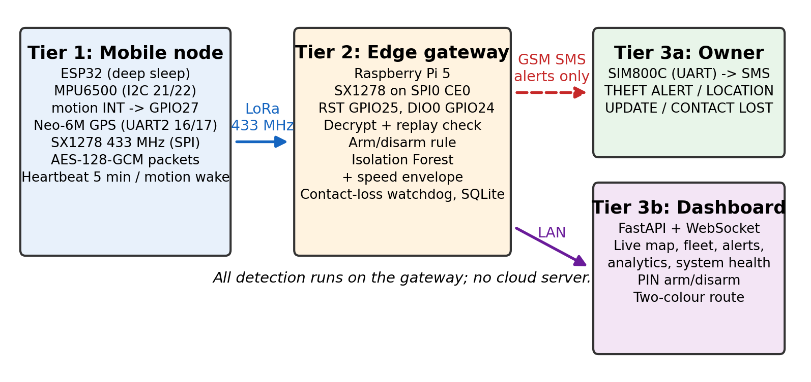
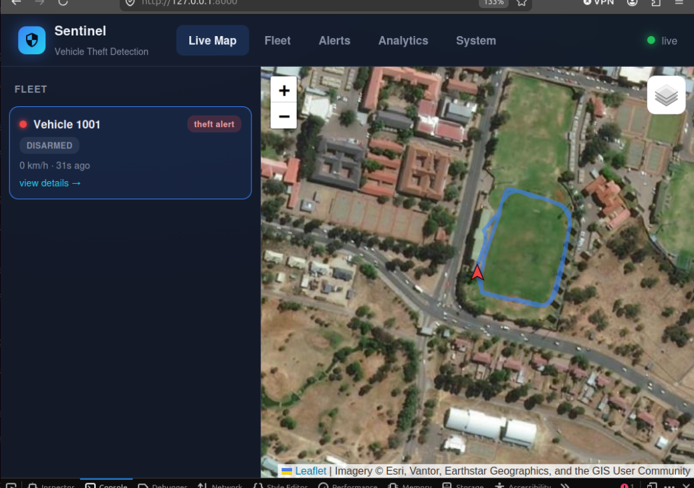
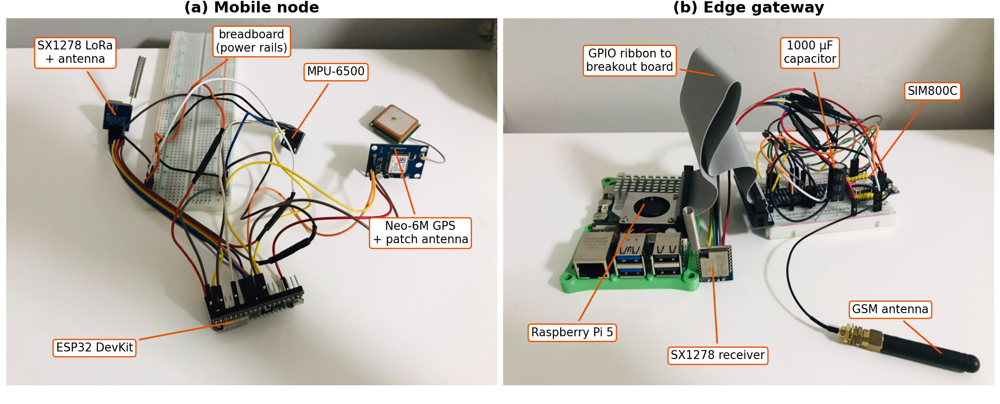
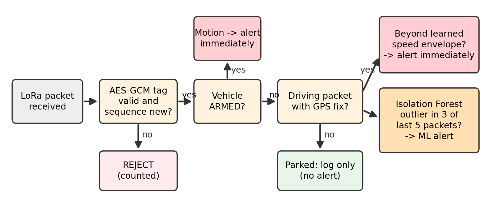
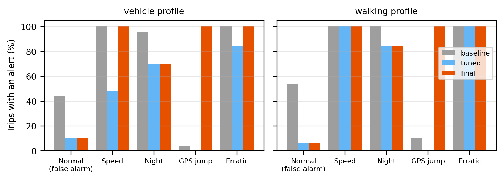
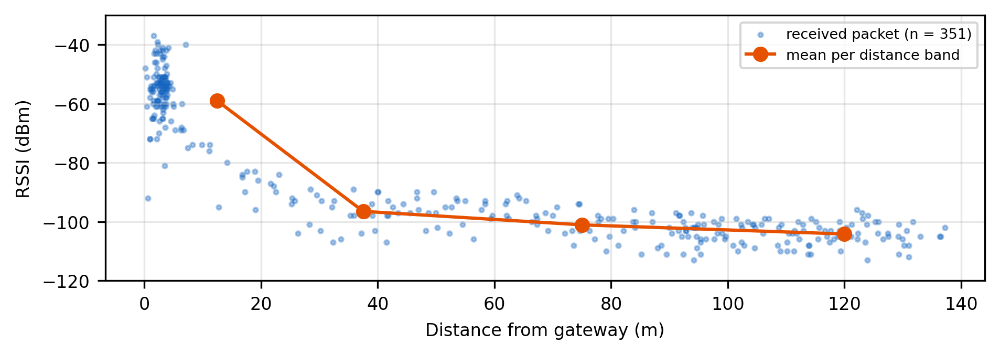

# Edge-Based Vehicle Theft Detection System — LoRa-GSM Hybrid Network

**IPJ527C: Advanced Research Project B — Final Version**  
Melusi Mlungisi Mabaso (221000343) · Supervisor: Dr P. Phoobane · Central University of Technology, Free State

An IoT vehicle theft detection system combining an ESP32-based in-vehicle sensor node, an encrypted LoRa telemetry link, a Raspberry Pi 5 edge gateway running machine-learning-based anomaly detection, a SIM800C GSM failover channel for SMS alerts, and a live web dashboard for tracking, arming/disarming and history.

## Testing without the hardware (for assessors)

The physical system needs the ESP32 node, LoRa radios, a Raspberry Pi 5 and a SIM800C. To let anyone test it on an ordinary PC (Windows, macOS or Linux, Python 3.10+), `gateway/simulate.py` runs the **real gateway code and the real dashboard**. Only the vehicle node, the radio and the modem are simulated: packets are encrypted into the exact 51-byte format the ESP32 sends, and SMS messages are printed to the console instead of being sent.

Download the code (green **Code** button → **Download ZIP**, then extract it, or `git clone` the repository), open a terminal in the extracted folder, and run:

```bash
cd 02_Edge_Gateway_RPi5
python -m venv venv
venv\Scripts\activate            # Windows   (macOS/Linux: source venv/bin/activate)
pip install -r requirements-simulation.txt
cd gateway
python simulate.py
```

The browser opens the dashboard at `http://127.0.0.1:8000`. Keep it beside the console window. Over about 4 minutes, seven scenarios play out:

| Scenario | What happens | What you should see |
|---|---|---|
| A. Parked, armed | Routine encrypted heartbeats | "parked, no motion — no alert"; vehicle green, marked ARMED |
| B. Owner drives | The owner disarms (PIN) and makes the usual trip | "driving judged normal by the Isolation Forest", no alert; route drawn **blue**; re-armed afterwards |
| C. Theft while armed | The vehicle is moved, then driven away fast | **THEFT ALERT — Moved while ARMED** SMS, then **LOCATION UPDATE**; vehicle turns red; route drawn **red** |
| D. Out of range | Packets stop | **CONTACT LOST** SMS with the last known position |
| E. Back in range | The node reports again | "contact restored"; still red until the owner disarms |
| F. Attacks | A replayed packet, a forged packet and an unencrypted packet | All three **REJECTED**; counter on the System page |
| G. Unusual driving while disarmed | Driven at ~140 km/h in an unusual direction | **THEFT ALERT — Faster than owner ever moves** from the learned speed envelope (ML layer), with no arming involved |

Before the scenarios, the simulation generates a week of normal history (parked and armed; disarmed for two short trips a day) and trains the Isolation Forest on the owner's driving. Timings are shortened for the demo (30 s SMS cooldown instead of 5 minutes, 20 s loss-of-contact timeout instead of 16 minutes). You can also arm and disarm the vehicle yourself on **Fleet → Vehicle 1001** with the PIN **1234**. The simulation uses its own database (`gateway/data/simulation.db`) and a random demo key, and never touches real gateway data. Stop it with `Ctrl+C`.

---

## Gallery

| | |
|---|---|
|  |  |
| **Three-tier architecture** — node, edge gateway, owner/dashboard | **Live dashboard** — route recorded around the CUT stadium |


*The assembled prototype: (a) mobile node — ESP32, SX1278, MPU-6500, Neo-6M; (b) edge gateway — Raspberry Pi 5, SX1278 receiver, SIM800C with bulk capacitor and GSM antenna.*

| | |
|---|---|
|  |  |
| **Decision logic** for every received packet | **Detector benchmark** — baseline vs tuned vs final (`ml_benchmark.py`) |


*Field test, 27 October 2026: RSSI of every received packet against distance from the gateway (98.9 % packet delivery).*

## 1. System overview

```
[ESP32 Mobile Node]  --LoRa 433 MHz, AES-128-GCM-->  [Raspberry Pi 5 Edge Gateway]  --SMS-->  [Owner's phone]
  MPU6050/6500                                         SX1278 receiver                          via SIM800C
  Neo-6M GPS                                           decrypt + authenticate + replay check
  SX1278 transmitter (10 dBm)                          arm/disarm rules + Isolation Forest
                                                       SQLite telemetry/alert store
                                                                  |
                                                        [Live Dashboard, FastAPI + Leaflet]
                                                        map, arm/disarm, alerts, analytics, health
```

The mobile node stays in deep sleep and wakes on a hardware motion interrupt or a periodic heartbeat timer. On a motion wake it immediately transmits a motion packet with its last known position, then acquires a fresh GPS fix and sends a second packet. Every packet is encrypted and authenticated with AES-128-GCM.

The Pi 5 gateway decrypts and verifies each packet and rejects forged, altered, replayed and unencrypted packets. It then decides:
- **ARMED** (parked, owner away): any motion is a theft alert.
- **DISARMED** (owner using the vehicle): the Isolation Forest, trained on the owner's own driving, alerts only on driving that doesn't match it, confirmed over several packets.

It also watches for silence: an armed vehicle that stops reporting (driven out of LoRa range, radio jammed, node destroyed) triggers a loss-of-contact SMS with its last known position. Everything is stored in SQLite, which the dashboard reads to show live positions, the two-colour route, alerts, analytics and system health.

## 2. Functions implemented

### Mobile Node (ESP32) — `01_Mobile_Node_ESP32/esp32_mobile_node/esp32_mobile_node.ino`
- Hardware-interrupt motion wake from deep sleep, by direct I2C register access, with **automatic MPU6050 / MPU6500 detection** (`WHO_AM_I`) and the matching motion-interrupt register scheme.
- Periodic heartbeat wake (timer-based) as a secondary wake source.
- **Immediate motion report**: transmits straight away with the last known position, then sends a follow-up packet once GPS has a fresh fix.
- GPS acquisition via Neo-6M/TinyGPSPlus with a bounded timeout and last-known-fix fallback (RTC memory).
- **Encrypted, authenticated packets (v3, 51 bytes)**: AES-128-GCM implemented in `aes_gcm_lite.h` (self-contained in the sketch folder, so it compiles on any ESP32 core version; verified against the gateway and NIST test vectors). The nonce is node ID + boot epoch (kept in flash, incremented on every power-on) + sequence number, so it is never reused.
- Transmit power **10 dBm** (ICASA's 10 mW limit for the 433 MHz short-range-device band); SX1278 put to sleep during ESP32 deep sleep.
- Battery monitoring via divider (calibrated `analogReadMilliVolts()`), switchable off when no divider is fitted.
- Bounded retries with graceful degradation for the motion sensor and the radio.

### Edge Gateway (Raspberry Pi 5) — `02_Edge_Gateway_RPi5/gateway/`
- `sx127x_lora.py`: from-scratch SX1278 receive driver (no LoRa library), protocol-exact with the ESP32 side, DIO0 interrupt reception, thread-safe access and a self-healing receive-mode health check.
- `lora_crypto.py`: v3 packet format, AES-128-GCM decryption and authentication.
- `generate_secrets.py`: creates the shared AES key (gateway `secrets.json` + ESP32 `lora_key.h`) and the dashboard PIN. Both files are excluded from Git.
- `sim800_gsm.py`: SIM800C AT-command driver with:
  - port and baud auto-detection, with clear diagnostics (e.g. a missing `dialout` permission)
  - SIM and network checks, reconnection and power brown-out detection
  - the 160-character single-SMS limit and verified, retried sending
- `telemetry_store.py`: SQLite layer shared with the dashboard (WAL mode), with automatic, lossless schema upgrades from every earlier version.
- `pi_gateway.py`:
  - **Security**: rejects forged, altered and unencrypted packets, and rejects replays with certainty using the authenticated (boot epoch, sequence) pair.
  - **Arm/disarm**: when armed, any motion is an alert and is never learned as normal. When disarmed, only the model can alert, and no loss-of-contact SMS is sent (the owner may simply have driven out of range).
  - **Isolation Forest**: trained only on the owner's driving (speed, heading as sine/cosine, speed implied by consecutive fixes, motion, time of day as sine/cosine). An alert needs **3 outliers in the last 5 driving packets**, which suppresses the ~5% of single normal packets the algorithm scores as outliers by design. History is rebuilt from the database on restart.
  - **Alerts**: theft alert, follow-up location update and loss of contact, all under 160 characters with a map link. A worker thread owns the modem, queues and retries SMSes, and records when each alert was triggered and sent.
- `eval_session.py`: labels evaluation tests (theft / normal / range / shield) while the gateway runs, then produces the results report. It measures detection rate, false-alarm rate, latencies, PDR/RSSI/SNR by distance and failover time, as Markdown, CSV and charts.
- `simulate.py`: the hardware-free simulation above.

### Dashboard — `02_Edge_Gateway_RPi5/dashboard/`
- FastAPI backend with REST endpoints, a WebSocket for live updates (telemetry, alerts, SMS confirmations, arm/disarm changes), and **PIN-protected arm/disarm** with a lockout after repeated wrong PINs.
- Multi-page Jinja2 web application that shares one layout and one WebSocket connection:
  - **Live Map**: status-coloured markers on switchable Dark / Streets / Satellite maps.
  - **Fleet**: searchable table with each vehicle's ARMED/DISARMED mode.
  - **Vehicle Detail**: arm/disarm button, the **two-colour route** (blue normal, red after a theft alert until disarmed), alert history and charts.
  - **Alerts**: the fleet-wide incident log.
  - **Analytics**: per-vehicle statistics and Packet Delivery Ratio.
  - **System**: gateway, modem, radio, **link security** and **rejected-packet** counters.

## 3. How to run / access the system

Full setup instructions:
- `Phase1_Hardware_Wiring.md` — pin-level wiring for the ESP32 node and the Pi 5 gateway.
- `02_Edge_Gateway_RPi5/Phase3_Setup.md` — interfaces, dependencies, **secrets**, running the gateway, arm/disarm, and the **evaluation tool**.
- `02_Edge_Gateway_RPi5/Phase4_Dashboard_Setup.md` — running and using the dashboard.

Quick reference, once hardware is wired and dependencies installed:

```bash
# Once, on the PC you flash the ESP32 from: create the shared key and dashboard PIN
python 02_Edge_Gateway_RPi5/gateway/generate_secrets.py
# -> flash 01_Mobile_Node_ESP32/esp32_mobile_node/esp32_mobile_node.ino (board: ESP32 Dev Module)
# -> copy 02_Edge_Gateway_RPi5/gateway/secrets.json to the same folder on the Pi

# Pi 5 gateway:
cd 02_Edge_Gateway_RPi5/gateway && source ../venv/bin/activate && python3 pi_gateway.py

# Pi 5 dashboard (second terminal):
cd 02_Edge_Gateway_RPi5/dashboard && source ../venv/bin/activate && uvicorn server:app --host 0.0.0.0 --port 8000
```

The dashboard has no user accounts. Arming and disarming are protected by the PIN in `secrets.json`, and the dashboard is intended for the local network only (see Limitations).

## 4. Requirements checklist (traced to the approved IPJ517C scope)

Full traceability, including justification for every hardware substitution, is in `REQUIREMENTS_TRACEABILITY.md`.

**Implemented:**
- ESP32 mobile node with deep sleep and hardware-interrupt motion wake (accelerometer, substituted for the SW-420; traceability §3.1)
- Neo-6M GPS acquisition with timeout and fallback
- LoRa telemetry link, SX1278/433 MHz (substituted for SX1276/868 MHz; §3.2), **encrypted and authenticated with AES-128-GCM**
- Raspberry Pi 5 edge gateway with fully local (no-cloud) processing
- Isolation Forest anomaly detection, per vehicle, unsupervised, with arm/disarm
- SIM800C GSM failover-only SMS alerting (substituted for SIM800L; §3.3), with queued retries and loss-of-contact alerts
- Live web dashboard including the **two-colour (normal vs. after-theft) route**
- Evaluation tooling for detection rate, false alarms, latency, PDR and failover

**Partially implemented:**
- Alert delivery channel: SMS only, of the three channels (SMS / app notification / direct call) the proposal names
- Jamming evaluation: simulated by shielding the node and by leaving LoRa range, not with an RF jammer (operating a jammer is illegal)

**Deferred (traceability §4):**
- Mobile app / direct-call alert channels

## 5. Known limitations

- **Shared static key.** All nodes and the gateway share one AES key, distributed by hand (`generate_secrets.py`). There is no key rotation or per-node key. Physical access to a node exposes the key.
- **Single fixed gateway.** GSM lives on the gateway, not in the vehicle, so a vehicle beyond LoRa range can't be tracked. That moment is reported (loss of contact while armed), but the vehicle is then lost. An LTE module in the vehicle is the production path.
- **2G-only GSM module.** The SIM800C uses 2G, which South African operators plan to switch off (national target: end of 2027). An LTE Cat-M1/NB-IoT module (e.g. SIM7080G) would replace it.
- **The owner must remember to arm.** A theft while disarmed is caught only if the driving itself is unusual. Auto-arming (e.g. after a period parked) is future work.
- **Isolation Forest tuning.** `ml_benchmark.py` showed that the beta setting (contamination 5 %) raised a false alarm on ~44 % of normal 15-minute trips and that an Isolation Forest misses speeds far outside its training range. The final version uses contamination 1 %, the 3-of-5 rule, and a learned speed envelope that alerts immediately (≥ 1.25 × the owner's fastest recorded speed). The benchmark is synthetic; real false-alarm rates must still be measured with `eval_session.py`.
- **GPS module always powered.** The Neo-6M draws ~45 mA in deep sleep, which dominates the node's battery budget. A MOSFET switch or UBX power-save mode would fix this.
- **Dashboard over plain HTTP, PIN only.** Suitable for a trusted local network; TLS and user accounts are needed before wider deployment.
- **Single-vehicle testing to date.** Multiple vehicles are supported architecturally but have only been tested in simulation.

## 6. Ethical, privacy and security considerations

- **Location data is sensitive personal data** (POPIA). The system records a vehicle's real-time and historical location. A deployment needs retention limits, owner consent and access control on the database.
- **The LoRa link is encrypted and authenticated.** Eavesdroppers can't read positions, and forged or replayed packets are rejected. The key files are excluded from Git and must be protected like passwords.
- **The dashboard has no TLS.** Anyone on the same network who knows the PIN can arm or disarm; anyone on the network can view positions. Keep it on a trusted LAN, or put it behind a VPN such as Tailscale.
- **Radio regulations.** 10 dBm transmit power keeps the node within ICASA's 10 mW limit for the licence-exempt 433.05–434.79 MHz band. Jamming was simulated, never performed.
- **False positives and negatives have real consequences** (a missed theft, or alert fatigue). Arm/disarm, the confirmation rule and the documented contamination setting are deliberate trade-offs, and are measured by the evaluation tool.
- **SMS alerts include exact coordinates.** They go directly from the SIM800C to the owner's phone; no third-party SMS or cloud service is used.

## 7. Testing

`TESTING_EVIDENCE.md` records the automated tests (with output) and every hardware/field defect found and resolved. This includes a host test in which the **ESP32 firmware's own encryption code** produced a packet that the gateway decrypted and verified.

## 8. Next steps

1. Run the structured evaluation with `eval_session.py` (theft armed/disarmed, normal driving, range, shield) and compare with GSM-only baselines from the literature.
2. Per-node keys and key rotation; TLS and user accounts on the dashboard.
3. Auto-arm after the vehicle has been parked for a set time.
4. LTE module in the vehicle node, to track beyond LoRa range and replace 2G.
5. App notification and voice-call alert channels.
6. ESP32 battery-life measurement and GPS power switching.
